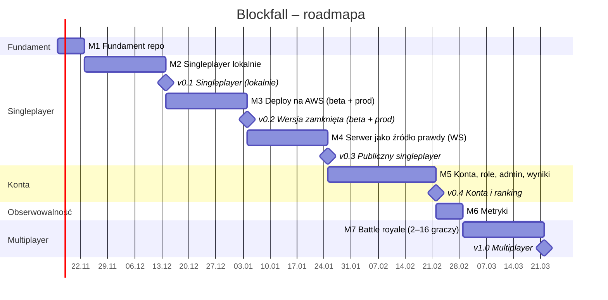

# Roadmapa

> Status: zatwierdzona (2026-11-13) · Ostatnia aktualizacja: 2026-11-13
> Estymacje zakładają pracę po godzinach (~10 h/tydzień). Daty są orientacyjne i aktualizujemy je po każdym milestonie.

## Oś czasu

## Wydania

| Wydanie | Po milestonie | Termin (orient.) | Co dostaje gracz                                                                          |
| ------- | ------------- | ---------------- | ----------------------------------------------------------------------------------------- |
| v0.1    | M2            | 14.12.2026       | Singleplayer w przeglądarce, lokalnie                                                     |
| v0.2    | M3            | 04.01.2027       | Nic publicznie: singleplayer na beta i prod za dostępem zamkniętym (tylko zespół)         |
| v0.3    | M4            | 25.01.2027       | **Pierwsze publiczne wydanie:** singleplayer liczony przez serwer, odporny na oszukiwanie |

> Zasada: publicznie udostępniamy tylko grę liczoną przez serwer. Do zakończenia M4 oba środowiska są zamknięte.
> | v0.4 | M5 | 22.02.2027 | Logowanie, zapis wyników, ranking, panel admina |
> | v1.0 | M7 | 22.03.2027 | Multiplayer: 1v1 i battle royale do 16 graczy |

## Milestones

| #   | Milestone                  | Zakres                                                                                                                                                                                                                                                            | Kryterium ukończenia                                                              | ADR-y                                                                                                                          |
| --- | -------------------------- | ----------------------------------------------------------------------------------------------------------------------------------------------------------------------------------------------------------------------------------------------------------------- | --------------------------------------------------------------------------------- | ------------------------------------------------------------------------------------------------------------------------------ |
| M1  | Fundament repo             | Monorepo (`apps/web`, `apps/server`, `packages/game-core`), TS strict, ESLint/Prettier, Vitest, CI (lint, typecheck, test), `docs/`                                                                                                                               | CI zielone                                                                        | monorepo, strategia testów                                                                                                     |
| M2  | Singleplayer lokalnie      | `game-core` w czystym TS (plansza, klocki, rotacje, kolizje, linie, punktacja, deterministyczny RNG), renderer canvas w React                                                                                                                                     | Grywalny singleplayer, deterministyczny `game-core`                               | współdzielony silnik, canvas vs DOM                                                                                            |
| M3  | Deploy na AWS              | Docker multi-stage, Helm, Terraform (VPC, EC2, ECR), k3s, Traefik, cert-manager, GitHub Actions: build → ECR → beta (merge do `main`) → prod (tag lub ręczne zatwierdzenie), dostęp do obu środowisk zamknięty (middleware Traefika: basic auth lub IP allowlist) | Singleplayer działa na `beta.` i prod za zamkniętym dostępem, deploy w pełni z CI | k3s na EC2, jeden klaster z namespace'ami, IaC, Helm vs Kustomize, promocja wersji, zamknięty dostęp przed publicznym wydaniem |
| M4  | Serwer jako źródło prawdy  | Express + WebSocket, `game-core` uruchamiany na serwerze, klient wysyła tylko inputy, typowany protokół wiadomości, reconnect, obsługa lagów, otwarcie prod publicznie (beta zostaje zamknięta)                                                                   | Singleplayer działa przez serwer, wynik liczy serwer, prod jest publiczny         | server-authoritative, `ws` vs Socket.IO, format protokołu                                                                      |
| M5  | Konta, role, admin, wyniki | Rejestracja i logowanie, sesje po stronie serwera (cookies `httpOnly`/`Secure`/`SameSite`, CSRF), autoryzacja WS przez cookie, role (`player`/`admin`), panel admina, zapis wyników w bazie, ranking                                                              | Gracz loguje się i widzi swoje wyniki, admin zarządza użytkownikami               | baza danych (Postgres vs Mongo), magazyn sesji, model ról                                                                      |
| M6  | Metryki                    | `prom-client` i `/metrics`, Prometheus i Grafana (kube-prometheus-stack), dashboard jako kod, logi JSON, podstawowe alerty                                                                                                                                        | Dashboard z beta i prod                                                           | —                                                                                                                              |
| M7  | Battle royale              | Pokoje 2–16 graczy (1v1 jako pokój dwuosobowy), lobby i matchmaking, garbage lines i targeting, eliminacje, testy obciążeniowe (k6)                                                                                                                               | Mecz 16 graczy na prod bez degradacji ticka                                       | model pokoju (uwzględnia limit 16 graczy), skalowanie pokoi                                                                    |

## Zależności

- M2 → M4: serwer uruchamia ten sam `game-core` co klient.
- M3 → M5: baza danych działa w klastrze z M3.
- M4 → M5: zapisujemy tylko wyniki policzone przez serwer.
- M4 → M7: multiplayer korzysta z protokołu WS z M4.
- M6 → M7: battle royale stroimy na podstawie metryk.

## Ryzyka

| Ryzyko                                                  | Wpływ                                              | Mitygacja                                                             |
| ------------------------------------------------------- | -------------------------------------------------- | --------------------------------------------------------------------- |
| Deploy przed logiką serwera (M3)                        | Pipeline trzeba będzie rozszerzyć o backend i bazę | Od początku deployujemy też szkielet serwera (`/health`)              |
| Wersja liczona w przeglądarce trafi publicznie przed M4 | Oszukiwanie, utrata zaufania do wyników            | Dostęp zamknięty do końca M4, otwarcie prod jako jawny krok w M4      |
| Brak metryk do M6                                       | Problemy na prod trudno zdiagnozować               | Logi JSON i healthchecki od M3                                        |
| Samodzielne utrzymanie k3s                              | Awarie, ręczna praca                               | Backupy, runbooki, warunki przejścia na EKS w ADR                     |
| Jeden klaster dla beta i prod                           | Awaria bety dotyka produ                           | ResourceQuota, NetworkPolicy, warunki rewizji w ADR                   |
| Bezpieczeństwo sesji (M5)                               | Przejęcie kont                                     | Cookies `httpOnly`/`Secure`/`SameSite`, CSRF, rate limiting logowania |
| Synchronizacja 16 graczy (M7)                           | Lagi, opóźnienie v1.0                              | Protokół sprawdzony w M4, metryki z M6, testy k6                      |
