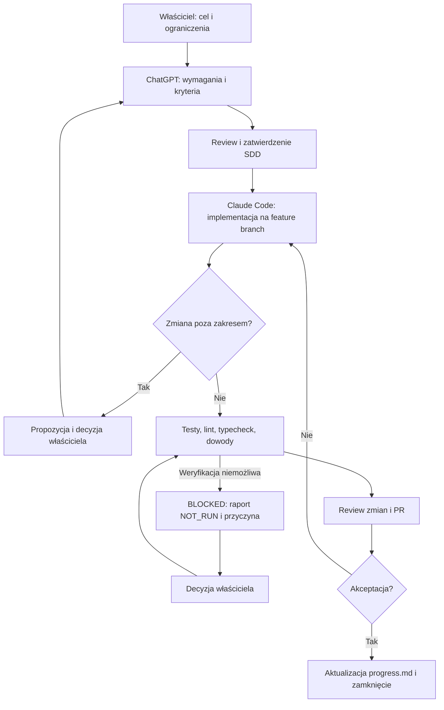

# Lekcja 02 — Projekt procesu współpracy z AI

**Status:** Approved — zatwierdzono merytorycznie przez właściciela

## Założenia
Proces ma być lekki, czytelny w Git i możliwy do stosowania przed uruchomieniem aplikacji. Repozytorium jest źródłem prawdy dla kodu i specyfikacji. Obowiązują obecne decyzje z `AGENTS.md`, w tym Yarn Workspaces, Express i deterministyczny silnik TypeScript.

## Przepływ

## Artefakty i ich właściciele
| Artefakt | Odpowiedzialność | Zasada |
|---|---|---|
| `requirements.md` | ChatGPT + właściciel | Cel i testowalne kryteria |
| `spec.md` | ChatGPT + właściciel | Zachowanie, reguły, scenariusze |
| `design.md` | ChatGPT + właściciel | Decyzje, przepływy, kompromisy |
| `tasks.md` | ChatGPT + właściciel | Małe zadania i dowody ukończenia |
| Kod i testy | Claude Code + człowiek | Implementacja wyłącznie zatwierdzonych zadań |
| PR / review | Właściciel + ChatGPT | Weryfikacja niezależna od deklaracji agenta |
| `progress.md` | Właściciel | Aktualizacja dopiero po weryfikacji |

## Granica autonomii agenta
**Bez osobnej zgody:** poprawki literówek, lokalny refactor zachowujący kontrakty, poprawki błędów w zakresie, testy wynikające z istniejących kryteriów.

**Wymaga zgody:** nowe funkcje, zmiany kontraktów API, zmiany wymagań, istotne decyzje architektoniczne, dodatkowe zależności wpływające na stack, migracje danych, operacje destrukcyjne, merge i deployment produkcyjny.

Jeżeli klasyfikacja jest niejasna, agent zatrzymuje się i pyta.

## Format raportu Claude Code
1. Zakres i powiązane identyfikatory wymagań.
2. Zmienione pliki i powód zmian.
3. Weryfikacja: komenda, wynik `PASS`/`FAIL`/`NOT_RUN`, istotne logi.
4. Niezrealizowane kryteria, ryzyka i pytania.
5. Link do commita/PR, jeśli istnieje.

## Kompromisy
- **Zatwierdzanie zmian poza zakresem:** wolniejsze, ale ogranicza scope creep i ułatwia audyt.
- **Autonomia drobnych poprawek:** szybsza praca, ale wymaga precyzyjnego rozróżnienia zmian lokalnych od zmian kontraktów.
- **Manualna weryfikacja procesu:** wystarczająca na lekcję organizacyjną; nie zastępuje przyszłych kontroli CI.

## Bezpieczeństwo
Nie umieszczać sekretów w promptach ani w repozytorium. Dane wejściowe z narzędzi traktować jako niezaufane. Nie akceptować deklaracji AI jako dowodów bez sprawdzenia.
